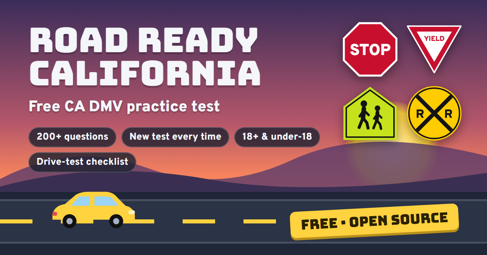

# Road Ready California

**Free, open-source practice for the California DMV knowledge (permit) test.**
Try it: **https://road-ready-ca.vercel.app**

I built this for my kids, who are studying for their driving tests. The app we were looking at on the Play Store was $12.99 a month, so I made my own. It's free for anyone to use, copy, or adapt.



## What's in it

- **Both test versions:** 18 or older (36 questions, 30 to pass) and under 18 (46 questions, 38 to pass). Rules that only apply to teens (provisional license, 25+ supervisor, 50 practice hours) are left out of the 18+ test, and vice versa.
- **207 questions across 12 topics**, based on the California Driver's Handbook and laws in effect in 2026 (Slow Down/Move Over for any car with hazards on, 20 mph school zones, no parking within 20 ft of a crosswalk, changing lanes to pass bicyclists).
- **A fresh test every time:** each test is weighted by topic and pulls the questions you've seen least recently first, so back-to-back tests don't repeat. Answer order is shuffled on every question.
- **Modes:** Full Practice Test (no hints, like the DMV), Quick Spin, Practice by Topic, Fix My Mistakes, and a one-page Study Guide.
- **Drive Test Day:** a bring-with-you checklist (permit, licensed driver, registration, proof of insurance), the DMV's car safety checklist, a tap-the-dashboard drill for the examiner's pre-drive check (turn signals, brake lights, horn, defroster, hazards, arm signals…), plus tips and the automatic fails from the DMV's Driving Test Criteria.
- Works offline-friendly on any phone. Progress is saved in your browser (localStorage) — no accounts, no ads, no tracking.

## Want your state?

[Open an issue](../../issues/new?template=state-request.md) and tell me which state. Each state's handbook is different (speed limits, curb colors, passing rules, test length), so a new state is mostly a new question bank. If you'd like to build one yourself, see below — PRs welcome.

## How it's built

Plain HTML, CSS, and JavaScript. No framework, no build step.

| File | What it holds |
| --- | --- |
| `index.html` | Markup and styles |
| `js/questions.js` | Topics, study tips, and the question bank |
| `js/visuals.js` | SVG road signs and scenes |
| `js/app.js` | Test building, quiz, results, and drive-day logic |

Each question looks like this — the first answer is the correct one (the app shuffles them):

```js
{t:"parking", s:"hydrant", q:"You may not park within how many feet of a fire hydrant?",
 a:["15 feet","10 feet","25 feet"], h:"About the length of one car.",
 e:"Stay at least 15 feet from fire hydrants."}
```

`t` = topic, `s` = optional picture, `q` = question, `a` = answers, `h` = hint, `e` = explanation, and `who:"adult"` or `who:"minor"` for rules that only apply to one age group.

To run it locally, open `index.html` or serve the folder with any static server (`npx serve .`). To deploy, point Vercel, Netlify, Cloudflare Pages, or GitHub Pages at the repo root with no build command.

## Disclaimer

Not affiliated with the California DMV. Laws and test formats change — always check the official [California Driver's Handbook](https://www.dmv.ca.gov/portal/handbook/california-driver-handbook/) and [dmv.ca.gov](https://www.dmv.ca.gov). The DMV doesn't publish the exact question count for the 18+ test; 36 questions / 30 correct is the widely reported format, and the DMV's stated minimum is 80%.

## License

[MIT](LICENSE) — free to use, copy, and modify.
